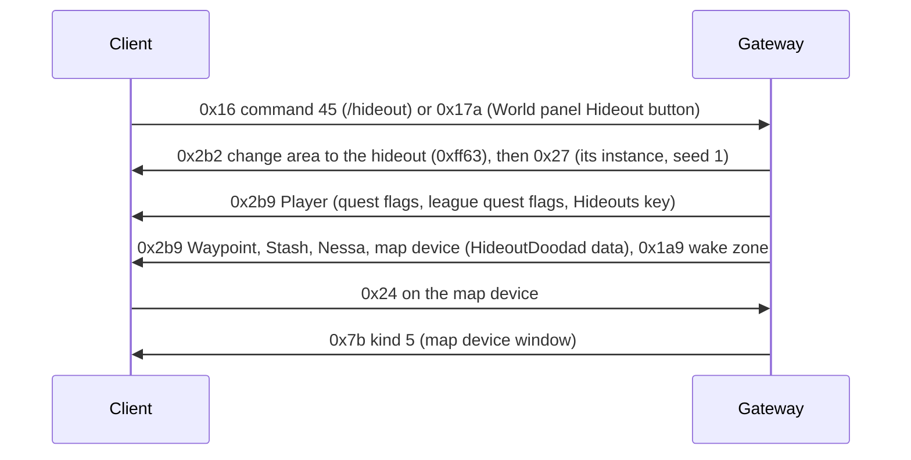
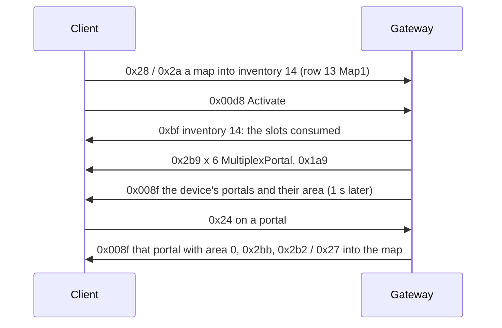

# 21. Hideouts

State of 2026-10-20: every character has its hideout unlocked and owns the Lush Hideout. `/hideout` or the World
panel's Hideout button takes the player there, next to its waypoint. The hideout has its Waypoint (travel back), its
Stash, Nessa and a map device that opens the map device window. The HUD shows the hideout Edit button. Verified live
(2026-10-20): travel, arrival, the stash, Nessa, the Edit button showing, the map device hovered, clicked and its window
opened. The map device runs maps (§5, live 2026-10-20): a map goes into its slots, Activate opens the map's area and
six portals appear around the device, each taking the player into that map once. Not done yet: the decorations,
editing, logging in to the hideout, where the player arrives in a map.



## 1. Unlocking: flags and keys

**All personal templates (2026-10-25).** Every exported Hideouts row is available on the local server
(103 templates in this client; all have personal eligibility enabled), including UnlockMtx templates.
0x1f6 sets the campaign unlock bits and the personal 0x1f5 response includes every exported row,
so MTX entries also pass the purchased-list check. The lists are derived from HideoutCatalog, not a
hard-coded count or byte range. This expands the picker; changing and persisting its selected template
remains unimplemented. Guild ownership is unchanged.

### Campaign unlock mask required by the picker (2026-10-25)

S→C **0x1f6** (class 0x1435c0758, writer 0x141f9e5c0) is exactly 16 raw bytes after the
message id: bit `row` unlocks that Hideouts.dat row (LSB first, zero-based). It is separate from
0x1f5's purchased-hideout list. Dispatcher case 0x95 at 0x142151d47 allocates a bit vector of
the Hideouts table's size, copies the corresponding mask bits and marks it initialized.
Without this packet the picker calls `0x14216d800` with a null vector at session +0xcdf0;
Windows recorded access violation **0x14216d8b7** on opening Helena's selector.
SendPlayer now sends the fixed mask before the player object, in every area, with the default
hideout unlocked. This also covers client-side opens that do not send an NPC option request.
The mask encoder tests cover empty input, byte/word boundaries, the highest bit and invalid rows.
Live picker confirmation is pending; choosing/persisting another template remains separate work.

| What | Where | Value |
|---|---|---|
| quest flag `HideoutUnlocked` | QuestFlags row 2030, Player +0x1b8 | every character (`Quests.EveryCharacter`, added on login, not saved) |
| quest flag HASH32 `0x2f1b9c25` | QuestFlags row 718 (the schema names it `HideoutJukeboxEnabled`) | the HUD's hideout panel checks it (`0x14216c840` → `0x1401ff190`) |
| quest flag `CanEditHideout` | row 2593 | tested before the Edit button shows (live flag trace); with it the button shows |
| quest flag `MapDeviceActive` | row 2582 | the map device's per-player "active" state (its `.ot`: `per_player_quest_flag_state_active_1`) |
| league quest flags `UnlockedHideouts` 3, `HaveHideout` 200, `UnlockedMapDevice` 350 | Player +0x1d0 | every character (`Quests.League`); the map device's Targetable needs `UnlockedMapDevice` |
| Hideouts keys | Player, two u16 after the 9 raw bytes (→ +0x1f8, +0x208) | the first is the Lush Hideout's Hideouts HASH16 `0xff63`; the second stays 0 |

**League quest flags** are a set of their own, not a table: the client has their names built in, sorted, with ids
(`0x142fca900`, 0x776 entries of {UTF-16 name, length, u32 id}; binary search `0x1423f1fb0`, wrapper `0x141de7f60`,
0x777 = unknown). They live in the Player component's **second flag set** (+0x1d0; same layout as the quest flags,
04 §4.6; update bit 0x08, `PlayerLeagueQuestFlagsUpdate`). **The client tests bit id − 1** (`0x14155cdf0`, and the map
device's Targetable at `0x141e65563`, which tested bit 349 for `UnlockedMapDevice` 350): `Quests.League.Bits`. Quest
flags (QuestFlags rows) are tested by row, without the shift. `/league_flag [<id> [off]]` (dev) sets them by id.

**How these were found:** a Frida hook on the flag-set test `0x14012aae0(set, bit)` logged each (caller, bit, result)
while hovering the map device and opening the HUD; the failing tests named the missing flags. The Player component
holds both sets (+0x1b8, +0x1d0); a copy of them sits in another object (+0x3c0 further on).

**The Hideouts keys** (reader `0x141e7dc10`, update bit 0x10 `0x141e7ee30`, `PlayerHideoutsUpdate`) are looked up by
HASH16 in Hideouts.dat (a failed lookup gives null). An update calls the component's vtable +0x130. Which UI reads
which key is not known; `/hideout_keys <a> <b>` (dev) sends both.

## 2. The hideout area and its decoration

Each Hideouts.dat row names its area (`HideoutArea`, a WorldAreas row with `IsHideout`) and its default decoration
(`HideoutFile`). The Lush Hideout: Hideouts row 0, WorldAreas `HideoutForest` (HASH16 `0xff63`, the same as its
Hideouts HASH16), found in The Dread Thicket. It is a fixed layout (one room, `forest_hideout.dgr` → `hideout.arm`,
21 × 21 tiles); the client generates it at seed 1 and reports a 253 × 253 walkability texture, a third of its 759 × 759
cells (Lioneye's Watch: 230 × 138 for 690 × 414).

A `.hideout` file is JSON (UTF-8 with BOM) whose `doodads` object **repeats keys**, one per placed doodad, named after it:

```json
"Waypoint": { "hash": 1224707366, "x": 218, "y": 335, "r": 16384, "fv": 5 }
```

| Field | Meaning |
|---|---|
| `hash` | MtxTypeGameSpecific HASH32; the HideoutDoodads row whose `MtxTypeGameSpecific` is that row gives the object type (`InheritsFrom`) and its models (`Variation_AOFiles`) |
| `x`, `y` | grid cells |
| `r` | rotation, 65536 = a full turn |
| `fv` | variation: index into `Variation_AOFiles` |

`dotnet run --project scripts/re/atlas -- Client/Content.ggpk hideouts` writes every hideout's decoration to
`data/hideouts.json` (game data, git-ignored; 103 hideouts, 14 150 doodads). The Gateway's `HideoutCatalog` resolves the
hashes. The Lush Hideout's: Stash (230, 364), Waypoint (218, 335, `waypointcore_forest.ao`), Crafting Bench (251, 351),
Map Device (449, 460; moved to (257, 283), the user's pick), lockers, the masters' spot (218..223, 325), and decorations.

**The HideoutDoodad component** (`0x141e1c550`) reads `u32` MtxTypeGameSpecific HASH32, `u8` variation and `u8` flag
(0 seen) **only when the object's data has +0x14e set**: never in town, always in a hideout. The Waypoint has the
component, so in a hideout it needs the 6 bytes (without them: "Buffer Underflow" on entry, live 2026-10-20).
`HideoutDoodad` record, `WaypointObject.Hideout`.

**Instances:** a private instance per character like other areas (Auth re-enters the character's live one); hideouts
always use seed 1, also where other areas get random seeds (`WorldAreaHideouts`).

## 3. Going there

| Message | Bytes | Meaning |
|---|---|---|
| C→S 0x16 command 45 | `0016 2D 0000` | `/hideout`: Commands.dat row 44 `WarpToHideout` + 1 (`SendsGenericCommandPacket`); the client never sends it as chat |
| C→S 0x17a | `017A 0008 446576576974636800 002F00 00` | the World panel's Hideout button: u16 n + n bytes UTF-8 character name (whose hideout), u32 BE the waypoint object the panel was opened from, u8 (0) |

Both change area to the character's hideout with the waypoint arrival (`PendingTransfer.AtWaypoint`): the player
appears next to the hideout's waypoint. The hideout's waypoint opens the World panel as any other (16-waypoints.md).

## 4. Objects in the hideout

| Object | Type | Blob |
|---|---|---|
| Waypoint | `Metadata/MiscellaneousObjects/Waypoint` | as in town (16 §2) plus HideoutDoodad after Animated |
| Stash | `Metadata/MiscellaneousObjects/Stash` | as in town (18 §1); no HideoutDoodad component |
| Nessa | `Metadata/NPC/Act1/Nessa` at (256, 351) | as in town (17); the real game has no town NPCs in hideouts |
| Niko | `Metadata/NPC/League/Delve/DelveMinerHideout` at (263, 344), Nessa's right on screen | its Delve options need quest flag ThisIsMyHideout (row 717) in NPCTalk QuestFlag1; rows with 717 in QuestFlag2 are the "not my hideout" variants (verified: without it only one Talk to Niko and Sell Items show). Every character has it; it is sent only in a hideout or the Mine Encampment (`PlayerQuestFlags`). Sell Items does not depend on it: the client shows Sell only in towns and hideouts (verified live: Niko in the encampment never lists it). They also need league quest flag 68 DelveEncounterComplete: NPCTalk columns 15-18 are league quest flag ids from the client's built-in table (`0x142fca900`, 24-byte entries of name, length, id; column 16 required, 18 refused; also 18 NikoDestroyedWall, 65 NikoCongrats, 1272 NikoOnKirac), given to every character (`Quests.League.EveryCharacter`). View Subterranean Chart: S→C 0x7b kind 0x1c (`DelveMapScreen` in the client's screen table at `0x142fc5920`: 24-byte entries of UTF-16 name, length, 0x7b kind). The chart then asks for its data with C→S 0x23f (just the id); S→C 0x240 answers (`InstanceDelve`, layout from the schema: u32, u16, u16 n × (u16, u16, u64, u8, u32)); an empty one is sent while the fields are worked out (verified live: the chart stops loading and shows its frame, the Mine Encampment entry, the resources column and the depth bar). One entry (0, 0, 0, 0, 0) makes the client draw a whole first section of the mine (passages, azurite, armour, weapon, ring and chest nodes, darkness below): it builds the section's contents itself, so an entry stands for a section the player has (verified live 2026-10-21; the other fields are still being worked out with `/delve_chart`). Visit Mine Encampment: to `Delve_Hub` as /goto (verified live: the encampment loads). There the tile's waypoint (333, 402) is created though WorldAreas gives the area no waypoint bit (`WaypointCatalog.DelveHub`), its StateMachine "active" is sent as 1 because no 0x4c bit can light it (being tested); Niko stands at (342, 410) as the hideout row (`DelveMinerHideout`): the hub's own row shows no Sell Items. The encampment also has a stash at (322, 412) and the guild stash next to it (`StashCatalog`). The mine's mechanics are not implemented |
| Kirac | `Metadata/NPC/Epilogue/KiracHideout` at (249, 358), Nessa's left on screen | has no NPCTalk rows of his own: his options and shop are the main Kirac's (row 410, `NpcCatalog.TalkSource`); Purchase Items sells maps (`NpcShops`). Being tested |
| Map device | `Metadata/Terrain/Missions/Hideouts/Objects/StrDexIntMappingDevice` | `HideoutObject`: Positioned (stash style), Animated `00`, InteractionAction `00`, HideoutDoodad, StateMachine (opening 0, active 1), MinimapIcon `00`, tasks |

The map device's `.ot`: Targetable `is_map_device = true`, `required_league_quest_flag = "UnlockedMapDevice"`;
StateMachine `define_shared_state = "opening; active;"` with `per_player_quest_flag_state_opening_1 = "MapDeviceOpening"`
and `…_active_1 = "MapDeviceActive"`. Clicking it sends C→S 0x24; the server walks there and sends **S→C 0x7b kind 0x2b** (`HideoutMapDeviceScreen` in the screen table at `0x142fc5920`), which opens the Atlas map device with its four starting map nodes. Kind 5 (`MapDeviceScreen`) opens the older, non-Atlas window; it has no node selection and opens the default layout. The hideout window's slots are Inventories row 13 `Map1` (3 × 2), already registered on login.

**Atlas node selection.** A click on a node sends **C→S 0x00e7** (5 bytes: u16 BE WorldAreas HASH16, u8 0x0d). The Gateway maps the HASH16 to an `AtlasCatalog.Layout` and stores it per character; the next generic map key opens that layout. The client refuses to activate an Atlas map unless the normal quest flag **EndGameAvailable** is set ("You do not have the required Quest State to access this area"; live 2026-10-29), so every character gets it..

## 5. The map device: slots, Activate, portals



**Slots.** Inventories row 13 `Map1` (3 × 2, inventory id 14) is an ordinary grid: items go in and out with the usual
item messages (13-items.md). The server takes the ItemClasses `Map`, `MapKey` and `MapFragment` there
(`PlayerInventories.Accepts`). Area-named maps need the item **Map** component (read `0x1423f3f10`, write
`0x1423f3e60`: u8 +0x19, u8 +0x18, u8 flag, then a u32 HASH32 when the flag is set; the server sends three zeros).
`/item Beach Map` makes one (`MapAtlasBeach`, tier 2). Generic 3.29 maps need the **MapKey** component (read
`0x1424ae7c0`: u8 flags, then optional u32/u16/u8; zeros are enough because `MapKeyTierN` names the tier, and the server
sends one zero byte). `/item Map (Tier 5)` makes a tier-5 map.

**Activate** is **C→S 0x00d8** (5 bytes): u16 BE, u8. The window's button handler `0x140c2a1c0` (window mode 0xd)
calls `0x142166480`, which writes a u16 from the target its slots name (+0x7b; 0 seen with a map in the slots) and a
u8 (0 seen); the writer class is `0x1435bff20`, as C→S 0xc7. Mode 0x5e (another device) sends C→S 0x296 instead.
The server checks the slots itself (`MapDevice.Check`): only maps and map fragments, and exactly one map. Otherwise
nothing is consumed and a chat line (S→C 0x17) gives the reason. Then the slots are emptied (0xbf), the map's area
opens (Maps.dat `BaseItemTypesKey` → `Regular_WorldAreasKey`), and six portals appear on a ring of 16 cells around
the device. Fragments are consumed with the map; `An Audience With The King` (`Metadata/Items/MapFragments/RitualBossFragment`)
may also be used alone, opening the Crux of Nothingness.

Generic 3.29 maps use the **MapKey** component (read `0x1424ae7c0`: u8 flags, then optional u32/u16/u8; zero is enough
because `MapKeyTierN` names the tier). `/item Map (Tier 5)` makes one. `MapKeys.dat` supplies its tier and the map opens
the Atlas layout selected for the character in the native panel; `/atlas <layout id or name>` is a dev fallback. The
first starting node (Cells) is the default. The selection is saved per character and restored on login. A generic
map's area level follows its tier (`tier + 67`: tier 1 = 68, tier 16 = 83); old area-named maps keep their WorldAreas
level.

**Portals** are `Metadata/MiscellaneousObjects/MultiplexPortal` (`MapPortalObject`): Positioned, BaseEvents, StateMachine,
Animated, Portal, Transitionable, MinimapIcon, InteractionAction, all read except BaseEvents (Frida
`check-components.js`: 36 bytes, nothing left). StateMachine holds PortalBase.ot's shared states (standard_portal 1,
portal, map_device_index, map_device_large). The Portal component (`0x141e2cee0`) reads one u8, the multiplex portal
type (`0x141e2cf40` stores it in the "portal" state; MultiplexPortal.ot: 1 player, 2 town, 3 map device, 4 map return).

**A portal object alone is never drawn.** **S→C 0x008f** (class `0x1435dcc00`, read `0x1421a0a00`; dispatcher case
0x21 → `0x142186070`) lists the device's portals:

| Field | Meaning |
|---|---|
| u8 | flags: bit0 → +0x32, bit1 → +0x33, bit2: a u64 follows at the end |
| u8, u8 | +0x2e, +0x31 (0) |
| u32 BE | the map device object (looked up; its Functions get `on_map_portal_opened` / `on_map_portal_closed`) |
| u16 BE, u8, u8 | +0x2c, +0x2f, +0x30 (0) |
| u8 n, n × entry | `0x1421b9af0`: u32 BE portal object, u16 BE area HASH16; when the area is not 0: u16 BE portal variation (MicrotransactionPortalVariations; 0 the default), u8, u8, u8 model (`0x141e2d240`: 0, 1, 2 pick three built-in models), wstr (the owner's name) |

For each listed portal object the client already has, PortalClient vtable +0xb8 (`0x14161a020`) gives it its area, its
model and rendering, and the device runs `on_map_portal_opened` (index, object). A portal that was listed before and
is now missing or has area 0 closes (+0xc0) and runs `on_map_portal_closed`. Seen live:
- 0x008f in the same burst as the portals' 0x2b9 reaches none of them (they are not created yet); on entering an area
  the objects also wait for the world to activate. The Gateway sends it 1 s after creating them (2 s on entry).
- Type 3 (map device) gets its nametag but no model: MultiplexPortal.ot enables its rendering only `on_transition`.
  Created untransitioned and opened with S→C 0x2ba to Transitionable (component 5, u8 1), the client hung, or
  crashed with the update 2 s later; that was before 0x008f had given the portal its area. **Type 1 (player) renders**,
  so the Gateway uses it (`Game_MAP_PORTAL_TYPE` overrides).

**Portal cosmetics without the shop.** The entry's u16 is the portal's own visual, so a shop portal effect replaces the
base one rather than adding a second object: `/cosmetic portal <name or index>` (Gateway) sets a per-connection
variation — a `MicrotransactionPortalVariations` row, e.g. 6 = Black Hole Portal Effect, 291 with an AOFile of 296 —
and re-sends 0x008f for the portals already standing (and every new portal is listed with it). The choice is saved with
the character (`CharacterSaves.Save.PortalCosmetic`, null for the base effect) and loaded when the instance connects, so
it survives a relog. `/cosmetic off` puts it back to 0, the base effect, and clears the field. `CosmeticCatalog` (Cosmetics.cs) names the rows through `MtxTypeGameSpecific` → `MtxTypes`. A name need not be exact: a number (the table's Index), any piece of the
name, or the whole of it picks one, and a piece several effects share is answered with the list of them and their numbers
(`CosmeticCatalog.Matches`) instead of the first being applied — the client's chat prompt completes nothing, so the list
is the completion ([10](10-chat-and-commands.md) §4).
That the client swaps the effect on a re-sent 0x008f is what the dev command tests; a portal whose variation the client
cannot resolve is expected to fall back to the default. Seen live 2026-10-21: the swap works — variation 6 draws the
Black Hole effect on all six Beach portals, in place of the base visual and with no second object. **The orientation is
the rig's own**: Black Hole's disc lies flat by design (as in the real game), and the portal's Positioned rotation is
ignored when the client places the shop rig — 0°, 90° and 270°, and portal types 1, 2 and 4 (`/map_portal 2|4`), all
render identically. `/portal_rotation <degrees>` (dev) still rebuilds the standing portals turned by that angle
(Positioned f32, radians = degrees × π/180), which is there for a rig that does turn out misoriented. Some effects also
ship as whole portal objects (`Metadata/Effects/Microtransactions/Town_Portals/…Portal/…`, e.g. AtziriMirrorPortal:
Positioned, BaseEvents, StateMachine, Animated, Portal, Transitionable, MinimapIcon, InteractionAction, ControlZone);
the variation route above covers the ones that are effect rigs only.

**Taking a portal** (C→S 0x24): the player walks there, the portal is sent with area 0 in 0x008f and removed (0x2bb),
and the player changes area into the map: the first portal makes a new instance (Auth "transfer" New), the others enter
that one (`MapDevice.Entered`). The open map is kept per character in the Gateway (`MapDevice.OpenOf`; lost on a Gateway
restart), so the portals left stand at the device again when the player comes back. A new Activate replaces them.
`/map_portal [type] [created] [open ms] [model]` (dev) places one test portal.

**Timing and order.** The portals left come up one after another, `Game_MAP_PORTAL_GAP_MS` (150) apart; each is listed
in 0x008f `Game_MAP_PORTAL_LIST_MS` (100) after its create; on entering the hideout the first waits
`Game_MAP_PORTAL_ENTRY_MS` (1500). With a list delay of 0 each portal is drawn only by the next one's list, so the last
never is (live). The open map keeps the places left (0–5 on the ring), so the portal taken is the one missing later.

**In the map.** Every area a map opens (`MapDevice.IsMapArea`) gets a portal back next to the arrival point, listed in
0x008f with device 0 (the handler then skips the device's events but still sets the portal's area): it leads to the
hideout and is not used up. The map's monster packs are its Maps.dat `MonsterPacksKeys` (Beach: `atlas-crab1`, level
69), which no MonsterPacks row lists by area (14-monster-packs.md). Beach's boss room (`MapBeach2/Rooms/boss_1.arm`,
points `teleport1-%areaname%`, `telepad1`, `teleport2-Arena`, `telepad2`) has two `grovewall_entrance` gates that no
topology transition names: two such captured gates are paired, each teleporting the player (0x1b7) next to the other
(`AreaTransitionObject.TeleportTo`); the telepads' own cells are not in `data/room-points.json`. Nessa sells 10 Beach
Maps. Beach's walk map is a `-Walkmaps` capture (2484 × 1656; spawn the deepest cell, (459, 884)).

**Portal Scroll** (C→S 0x58, `UsePortalScroll`). Outside towns and hideouts one scroll is spent and the same portal object
opens 3 cells beside the player, listed in 0x8f with device 0. There is one per player: a new scroll closes the old portal
(0x8f with area 0, then 0x2bb) and moves it, the map's own portal back included. From a map area it leads to the hideout,
anywhere else to the character's last town (`ClientState.ReturnPortalTo`), at its spawn. In a town or a hideout
nothing happens and nothing is spent. Live 2026-10-21: in a map and in the acts. Not yet: the portal's other end in the
town (the way back), and the portal staying after the player leaves the area.

## Open

Helena (2026-10-25, client verification pending) is placed at (270,337), screen-right of Niko,
using `Metadata/NPC/Missions/Hideout/Helena` (NPCs row 342). Her own NPCTalk option 2,
category `SelectHideout`, requires ThisIsMyHideout and HaveHideout, already supplied in hideouts.
The handler closes dialogue with 0x84 object 0 and opens UI 0x7b kind **0x22**, argument 0
(HideoutSelectionWindow in the native screen table 0x142fc5920; argument 1 is guild mode).
The owned-hideouts response 0x1f5 now lists the default Lush Hideout rather than an empty list.
The owned list now includes all exported personal templates, including MTX.
Selection is implemented as described below.

- The decorations (trees, tents …): `Metadata/MiscellaneousObjects/HideoutDoodad` and other types, each with its own
  component list; `HideoutObject` writes the supported ones.
- Editing: the Edit button shows; moving, placing and saving doodads (the client's messages) are not served.
- The map device: the arrival in a map without a walk map (the player can stand in the sea; `live.ps1 -Walkmaps` per
  map), the telepads' exact cells, device recipes (MapDeviceRecipes), the map's mods and area level, the map
  device type (3) portal's own model and "Map Portal" text (needs its open transition, which crashed), the window's
  u16 target and the 0x008f fields left at 0.
- Resurrect in a map → the hideout.
- Visiting other players' hideouts (0x17a names them).
- Which UI reads the second Hideouts key.

## Crafting bench placement (2026-10-25)

After spawning a hideout's guild stash, the Gateway creates the standard HideoutCraftingBench
from that hideout's existing decoration template. The original Mtx hash, variation and rotation
are preserved. Placement is relative to the guild stash: grid offset (-12,+12), with nearby
screen-left alternatives if its 5x5 footprint is blocked. It receives 0x2b9, 0x1a9 and a walk blocker.
The bench is deliberately separate from the map-device dictionary, so portal creation and map
activation still target only the map device. Towns and the Mine Encampment do not get this bench.
No generated game-data format changes are needed. Placement was confirmed in the real client.

The connection retains the bench's object id and grid position separately from map devices.
C→S 0x24 on that id walks up to the bench; movement cancelling the approach, a closed connection
or an unreachable stopping point prevents opening. Once in range, S→C 0x7b **kind 0x33, first
u32 = 0**, remaining u32s zero, opens the ordinary crafting window. The first u32 is a
CraftingBenchTypes row, **not the object's id** (row 1 selects runesmithing).

Client trace: `0x142163420` case 0x33 dispatches to instance +0x22f8; HUD registration
`0x140dbcd40` uses thunk `0x140dae898`, which calls virtual +0x8e0, `0x140ddb5c0`.
That forwards the bench type to `0x140c3e600`, opening the window at HUD +0x880
(constructor `0x140c3b650`). Its item control binds to inventory row 16 in `0x140c3e1c0`;
the Gateway already registers this row with the other player inventories on entry.
`0x140c45830` selects the bench's visual skin from the placed hideout decoration, falling back
to Default. UI kind 0x65 is for dynamic benches and is not the ordinary hideout bench.

The opening packet is covered by an automated test; live window opening awaits a reconnect.
Recipe unlocks and applying craft requests are implemented below.

## Ordinary bench recipes and payment (2026-10-25)

`BenchCrafting` loads all **765 active ordinary recipes** from CraftingBenchOptions, excluding
disabled and area/map-device rows. Class eligibility comes from explicit ItemClasses or the
CraftingItemClassCategories union. Exact crafted Mods.dat keys (domain 9), enchantments and
multi-currency costs come directly from the client tables. No hand-written list of craft values
is used. The recipe rows' 130 distinct RecipeIds are league quest flags: unlock tests in
0x140c4c720 read the local Player component +0x1d0 with flag id minus one. Every connection
publishes those flags with the player, making all active recipes available on this local server.

The craft button (0x140c40720) sends **C→S 0x15d**, exactly four bytes. Serializer
0x141f9b2e0 writes u16 message id and u16 recipe row, both big-endian. Bit 15 of the row is set
only by the window's second button (+0x308), which first shows the Tencent "Bound Currency
Crafting" confirmation (TencentBoundCurrencyCraftingConfirmationTitle); the local server ignores it. The target is the one item in Inventories row
16, StrMasterCrafting (inventory id 17). Requests are served after opening the bench in a hideout.

Ctrl + click with the bench open sends **C→S 0xe9** (7 bytes; 0x14030e3e0 → 0x142167ed0, serializer
0x141f98e80): u16 id, u32 item id, then a flag byte. 0x80 is set when the clicked item is in the
player's inventory (move it onto the bench), clear when it is the bench's item (row 16, move it back);
0x40 marks an item in ExpandedMainInventory1 (row 84). The server moves the item, keeping its id, onto
the empty bench slot or into the main inventory's first free cell, and answers with two 0xbf changes;
a taken slot or a full inventory leaves it where it is. The same handler shape (0x142167f20,
0x142167f70, 0x142167fc0) covers other crafting panels (rows 0x1b, 0x1f, 0x10 with class checks).

Supported operations: add/replace crafted prefixes and suffixes; the three-crafted-modifier
metamod and additional-crafted-mod enchantments; remove crafted mods; add/remove flask
enchantments; exact socket count and link count; non-white socket recipes; rarity reroll; and
one/three-affix rare-item rerolls. Affix slots and conflicting mod families are checked. Magic
items have one prefix/suffix slot, rare equipment three; normal items become magic when a
mod is crafted. Replacement needs no separate request: the client relabels the Craft button
"Replace" (CraftingModReplace) and sends the ordinary 0x15d (verified live: bit 15 clear). The
server removes the one crafted mod the new one conflicts with (same mod or shared family), or the
single crafted mod when the crafted-mod limit is reached, and charges only the recipe's cost. More
than one crafted mod to remove is refused (CannotReplaceMultipleModifiers); with the multimod
(limit 3) only the conflicting craft is replaced and a fourth non-conflicting craft is refused.
Fractured crafted mods are never replaced. A refused craft logs its recipe and the bench item. Unidentified,
unique, fractured and protected items are checked according to the requested operation.
Socket crafts bypass item-level socket caps but respect base capacity; occupied sockets are
never discarded. Corrupted socket crafts add the same number of Vaal Orbs as the base cost.
Mirrored items are never modified. Rare-affix rerolls preserve fractured/protected mods and
respect Cannot roll Attack/Caster via the Mods.dat TagsKeys. Random affix/rarity probabilities
use the existing server rolling model; these distributions are not reverse-engineered official odds.

`ItemMoves.CraftAtBench` validates the item and **all** currency totals before its first write,
then pays from the main inventory first and the remainder from any personal stash tabs. The
item and every payment commit in one Saves transaction. A missing currency or invalid recipe
does not spend anything; save failures roll back both sources and target. The existing stash
currency preloading on area entry feeds vendor prices, but does not suffice for the bench
affordability UI (see the balance correction below). Each payment sends inventory changes and updates the loaded stash tabs; the crafted
item is removed/re-added with the same id via 0xbf. Guild stash currency is not used.

Tests cover every recipe against supported item classes, raw-table costs/class masks/unlocks,
rolled values, confirmation and extra scouring, multiple sources/tabs/currencies, insufficient
funds, save rollback, multimod/affix caps, protected prefixes, and corrupted socket costs/gems.
After Gateway restart, client validation still requires opening the bench, crafting and checking
the wallet/item result; automated tests do not substitute for that live UI check.

### Bench affordability: personal stash balance (2026-10-25)

Live report: recipe costs stayed red despite sufficient stash currency, and no 0x15d request
was sent. The bench uses its own currency counter: 0x140c3aa80 checks cached counts at
counter +0x110; inventory filter 0x140c3b490 rejects equipment/read-only inventories and
ordinary stash kind **0x11**, while accepting currency-count kind **0x12**. Thus loading
real stash inventories for vendors did not initialize the bench's balance.

`BenchBalance` builds a client-only view of current personal stash totals for every recipe
currency, including corrupted-socket Vaal costs. It is sent before
opening the bench using 0xc0, inventory id 0xfffffe00, kind 0x12, row 26. Row 26 deliberately
does not overwrite the native manager's fixed inventory-slot lookup (0x141d625f0). The
ordinary 0x1421f4cc0 reader/0x1421edc10 constructor supports this kind; no client files change.
The view includes **stash only**: the native counter already counts actual main-inventory
currency. Large totals are split into 16-bit stacks without changing their sum.

Opening again rebuilds current totals. Each successful craft and a refused request refresh
the view with 0xbf, removing old display entries before adding the new ones. Opening the
personal stash or an NPC shop clears it, avoiding duplicate counts in other windows.
Display ids are never saved, never added to real inventories, and their inventory id resolves
to neither a character row nor a stash tab; requests to move/spend those display entries
cannot touch the real wallet. Payment continues to use real stash/inventory data atomically.

Tests check the wire inventory kind/id/flags, multiple-tab totals plus main inventory without
double counting, depletion after payment, exclusion from actual inventory routing, and totals
above 65535. This is an automated/native-code verification; the corrected affordability UI
still needs a live reconnect/open/craft check.

## Selecting and retaining a personal hideout (2026-10-25)

The Choose button sends C→S **0x254**, followed by one big-endian u16: low 15 bits are the
Hideouts row index, bit 15 is guild mode. Native sender: 0x140bbae90; serializer: 0x141f9d070.
Captured personal selection `0254001D` selects row 29. The Gateway frames all four bytes,
rejects unknown rows and guild requests, saves `SelectedHideout` as a stable WorldAreas Id,
updates the player's Hideouts component and uses the normal acknowledged area-transfer path.
Selecting the current template keeps the character in place.

Auth reads the shared character save on each login and enters the selected home directly;
characters without a saved choice retain last-town login. `/hideout`, world-panel travel,
map return portals and the player's hideout key all resolve the same saved choice.
Entry uses the selected template's waypoint and fixed seed 1.

`HideoutScene` recreates personal/guild stashes, crafting bench, map device, Nessa, Niko,
Helena and Kirac on the destination floor. It retains decoration appearance, translates NPC
positions relative to the new waypoint, and searches for nonoverlapping walkable footprints.
The default template supplies missing functional furniture. Arbitrary decorative object placement/removal remains outside this implementation.
Moving the installed furniture and NPCs is described below. Automated coverage checks
selection bytes, persisted choice and placement; final client verification requires selecting
a different template and reconnecting after restarting both Auth and Gateway.

### Moving installed furniture and NPCs

The native Edit UI sends C→S **0x5b**, 15 bytes, when a selected object is dropped or rotated.
Sender `0x142160100` is called by editor callbacks `0x140204880` and `0x140204ae0`.
Serializer `0x141f93820` and reader `0x141f93920` agree on this layout:

| Field | Encoding |
|---|---|
| Message id | u16 BE, 0x5b |
| Runtime object id | u32 BE |
| Grid x, y | two u16 BE |
| Appearance flags | u8: bit 0 mirror, bits 1-7 variation |
| Rotation in radians | raw IEEE-754 f32 bits as u32 BE |

Captured `005B0000300A010B00EA0000000000` moves object 0x300a to (267,234), rotation zero.
Previously this packet was unframed and discarded, so the editor reverted the attempted move.
It now has an explicit framing length, including when followed by another message in the same read.

The Gateway accepts registered functional objects and NPCs only in the character's selected personal hideout.
Town objects, pets, portals, unknown ids, out-of-grid/blocked terrain and nonfinite rotations are rejected.
The terrain check needs the template's captured walk map (`live.ps1 -Walkmaps`). A template without one has a
0 × 0 grid, so the server skips the cell check and relies on the native Edit UI's placement check
(`HideoutEditing.Cells`). Without that fallback every move in an uncaptured template was refused.
A move in a hideout other than the character's selected one is logged as refused, with the reason.
The Edit toggle is local client UI state; no separate server edit-mode toggle was observed.
This implementation applies translation and rotation; variation and mirroring changes are not implemented.

Save first, then update the runtime interaction coordinates, path blockers, NPC lookup and device placement.
S→C 0x1b7 moves the existing object with terrain-height marker 0x7fffffff.
S→C 0x2ba updates Positioned (component 0): LE u16 mask 8 followed by LE f32 radians.
The update reader is `0x141e30910`; ordinary furniture/NPC edits preserve the existing object.
Map devices declare `static = true`, `object_size = 4` and `blocking = false` in CraftingBenchBase.ot;
client collision comes from their AO Hull, rather than that small Positioned footprint.
After position and rotation updates, send S→C **0x161**, followed by its unused zero object header
(u32 object id, u32, u16; all zero). World handler `0x142187480` calls `0x142185500`, which restores
the two baseline hideout walk grids saved at world +0x998, then `0x141d88690` reapplies all current model hulls.
A teleport, remove/recreate or HideoutDoodad component refresh alone leaves stale blocked cells in hideouts.
The object id, device state and portal list are preserved; no object recreation is needed.
The server replaces its blocker by id and restores it at the saved position on entry.
NPCs, personal/guild stashes, the crafting bench, Harvest station and Heist Locker share
`RegisterStationaryCollision` at spawn in towns and hideouts. `object-types.json` version 3 carries inherited
Positioned object_size/blocking/static/block_league_flag plus Animated's model. NPC Id aliases resolve through NPCs.dat Metadata.
When local guild storage is spawned, its block_league_flag HaveGuild (native id 2) is included in the player's
league flags through the ordinary Player component update. GuildStash's native collision predicate checks this
flag even though the local storage is per-account and no real guild membership is implemented. Disabling the
Positioned blocking flag through 0x2b0 is incorrect: it also removes the stash from blocking spatial buckets.
Blocking objects use object_size minus one (Heist Locker 2, Harvest station 7); static nonblocking objects use
their model hull (ordinary crafting bench about 9.273 cells). Interaction approaches use the registered clearance.
A nonblocking object has editor size -1, distinct from a blocking object whose size is 0.
Waypoints and dropped loot remain traversable; built-in scenery remains governed by the area's terrain walk grid.
The complete stationary scene is registered before arrival collision correction, in addition to regular tick checks.
Live checks covered all nine functional hideout objects (Nessa, Niko, Helena, Kirac, both stashes, both benches
and the Heist Locker): each was moved onto the player, ejected the player, restored, and its former centre reached.
In Lioneye's Watch, native walking stopped outside Tarkleigh, Nessa, Bestel and both stashes, including the guild
stash after its normal access flag was supplied. Test placements were restored and the character returned home.
All supported NPC types also have automated metadata and collision-escape checks; other towns share this spawn path.
`hideouts.json` version 3 extracts conservative rotation-independent collision radii from native AO `walk_tri`
and `walk_circle`, including inherited AO files, for map devices, bench variants and static NPC models.
Map-device radii are about 7.236 cells for CartographyDevice2 and 30.662 for the large MTX model. The server uses
these radii plus mover clearance when routing and ejecting the player; it does not rasterize the exact triangles.
Already-open portals remain in their current positions; subsequent portals use the device's new position.

`CharacterSaves.HideoutPlacements` stores placements by WorldAreas Id and stable furniture/NPC keys.
Runtime object ids are not saved; reconnecting or restarting restores the positions for that template.
Different characters and different templates keep independent layouts.
A failed save leaves the previous placement authoritative and closes the connection through normal error handling.
Stash interaction now approaches its runtime position, including after a move in any selected hideout.

Tests cover captured framing, rotation endianness, invalid requests, persistence, save failure and scene restoration.
CollisionEscape finds the nearest clear cell against terrain, quest barriers and all stationary blockers.
It uses the player's mover clearance and ignores mobile monsters for this correction.
A successful correction invalidates the current action/channel, updates the server walk origin, sends ActionEnded
and teleports the player with terrain-height marker 0x7fffffff.
Checks run after edits and during player ticks, covering a blocked entry cell as furniture is restored.
Search is bounded to 128 cells; no teleport is sent if no safe destination exists within that search.
Regression tests cover overlapping blockers, map edges, blocked terrain, released old positions and save/reentry state.
Real-client checks moved the small map device onto the player on clear floor: the player escaped 9.434 cells,
could walk immediately, and could reach the former device centre after the device was restored.
Large-model radii, bounded path progress and save/reentry persistence have automated coverage; large-model
and wall-adjacent layouts still need separate live checks.
Real-client movement/rotation and reconnect persistence were checked for the map device, Nessa and personal stash.
The test placements were returned to their original positions afterwards.
Other registered objects share the same update path; their individual Edit UI interactions still need manual checks.

### Heist Locker

Every hideout scene includes `Metadata/MiscellaneousObjects/Heist/HeistStash_Hideout` on clear floor.
It is placed after the existing furniture/NPCs, so adding it does not change their default positions.
Its serialized components are Positioned, BaseEvents, Animated, MinimapIcon and InteractionAction.
The model is supplied by the native object type; no Stash or HideoutDoodad payload is present.
It registers a size-4 path blocker and the stable editor key `heist-locker`.
Movement/rotation updates interaction coordinates and persists with the template's other placements.

C→S 0x24 interaction approaches the locker, validates arrival, then sends S→C 0x7b kind **0x37**.
The four u32 arguments are zero; this is distinct from ordinary stash kind 1 and guild stash kind 2.
Native dispatch: `0x142163420` case 0x37 -> instance +0x5278 -> `LAB_140dae778` -> HUD virtual +0xcf8.
PC handler `0x140dcf150` opens HUD +0x8d8 and raises HeistStashOpen.
HeistStorage1 (Inventories row 56, kind 0x24) is already included in the player's default inventories.
This change adds placement and the native window entry point; Heist storage transfers are not newly implemented.

Real-client verification sent the locker interaction and observed the native handler completing with the actual
Heist window visible (flag 0x800 at +0x1e8) and its open marker set (+0x338), while the client remained in game.
Tests cover placement across exported templates, editor restoration, native component order and the open message.

### Horticrafting Station (recipe browser and execution)

HideoutScene places `Metadata/MiscellaneousObjects/Harvest/CraftingSilo_Hideout` beside the ordinary bench on clear floor in every selected hideout. The object has Positioned (blocking size 8), BaseEvents, Animated, MinimapIcon and InteractionAction, with no HideoutDoodad or StateMachine payload. Its built-in Animated model is harvest_workbench.ao. The Gateway registers a blocker and handles its 0x24 interaction separately from the ordinary bench.

After walking within range, send `0x7b` kind **0x39**, four zero u32s. Native dispatcher 0x142163420 uses instance +0x4ef8; HUD callback LAB_140dae88c invokes virtual +0xcc0, PC 0x140dcee40 (window +0x8b0) / controller 0x140d8d750 (window +0x4a8). This differs from 0x33 ordinary crafting and 0x45 Sanctum.

The native Harvest panel builds the complete recipe list from HarvestCraftOptions.dat (0x14048dd00), with its own search/filter, current game-mode filtering and localized descriptions/costs. No ordinary bench unlock flags or server-manufactured recipe list are needed. HarvestCraftingItem (Inventories row 43, inventory id 44) is already registered with the player's defaults.

The panel's craft button sends **C→S 0x274**, exactly four bytes: u16 message id and u16 **HASH16 of the selected HarvestCraftOptions row** (for example ReforgeFire 0xa3e5). Serializer 0x141f92870 writes the two big-endian words; the PC callback is at 0x140491622 (the second send at 0x1404916e5 is the same request). The live capture was `0274A3E5`. The target is the one item in HarvestCraftingItem; there is no item id in the request. A station craft is served only after its browser was opened in a hideout.

After a request the client sets the panel's pending flag and ignores slot/item changes until it gets **S→C 0x276**, six bytes: u16 message id, u16 crafted item id, then two unused bytes. Dispatcher case 0xce (`0x142153bd2`) reads four raw payload bytes and dispatches the first u16 to the local event list at instance +0x4e70; the Harvest panel looks that item up in HarvestCraftingItem, clears the pending flag and refreshes the slot. The server sends the slot's item removed and re-added as separate 0xbf changes, then the payments, then this event. Without 0x276 the Craft button locks after one use (live); a short packet desynchronises the reader and can show an unrelated result string.

`HarvestCrafting` loads all 74 rows and their exact costs: `LifeforceType` 1/2/3 is Wild/Vivid/Primal Crystallised Lifeforce (`HarvestSeedRed`/`Green`/`Blue`), plus `SacredCost` of Sacred Crystallised Lifeforce (`HarvestSeedBoss`). `ItemMoves.HarvestAtStation` validates the item and every cost before the first write, pays from the main inventory first and the rest from the personal stash, and commits the item and payments in one Saves transaction. A refusal spends nothing. Inventory/stash changes and the changed item in row 43 go out as 0xbf updates, like the ordinary bench.

Implemented recipes are `reroll_with_mod` (a rare item reforged with at least one modifier carrying the requested Tags.dat tag), `reroll_with_current_tags_affinity_multiplier` (reforge weighted by tags the current affixes share; the client's 900 / -90 is a local 10× / 0.1× weighting, not an official probability), `remove_type_and_add_type_mod` (remove one random removable affix, then add the tagged affix), and `convert_mod` (replace a modifier's ModType group with the reversed recipe's same-tier group, for example ColdResistance → FireResistance). The last uses ModType.dat names (`ModTypeKey`), not Mods.dat ids. Corrupted, mirrored and unidentified items and items with bench metamods are refused.

The remaining rows are explicitly unsupported and spend nothing: influence rerolls, stack exchanges (fossils, oils, catalysts, essences, splinters, Delirium orbs, astrolabes, fragments, divination cards), divination-card gambles, gem lenses/recolours, corrupted maps and Harvest quality enchants. Their prerequisite systems are tracked separately.

Tests cover raw-row hashes/costs, a guaranteed-tag reforge, augment removal+addition, affinity shape, ModType conversion, refusal cases, split inventory/stash payment, insufficient funds, save rollback and the 0x276 result packet. Station placement, native window opening, the actual 0x274 request and repeated crafting without reopening were confirmed in the real client.

### Arrival on the saved waypoint

Before serializing the player, PrepareHideoutWaypoint restores the character's saved waypoint position.
It sets the hideout spawn and movement origin to that exact cell, rather than a nearby cell or old template spawn.
This applies to login, waypoint travel and returns from other areas; moving the waypoint changes later arrivals.

## Delve: sulphite and the Crawler (live 2026-10-29)

- **S→C 0x228** (class `0x1435dc940`, read `0x1421ad670`, dispatcher case 0xa9 at `0x142152f98`): u8, 20 raw bytes, 14
  raw bytes. The handler builds a 34-byte record at instance `+0xd874`: the 14 bytes first, then the 20. It sets
  `+0xd896` = 0x101 and raises the event at `+0x2878`.
  - Record `+0x1e` (bytes 16..18 of the 20, little-endian) is the current Voltaxic Sulphite.
  - Its capacity comes from bytes 0..16 (`0x14246e390`, the upgrade levels).
  - S→C 0x226 (u16 old, u16 new) changes the current value. 0x227 (u32) changes the record's `+0xe`.
  - `InstanceDelve.DelveData` writes it.
- **The gauge** (`delve_energy_bar`, `0x14042e790`, built with the HUD by `0x140db0150`). It is updated on area entry
  (S→C 0x21, `0x14042fff0`) and shown when both of these hold:
  - the area is not of kind 0x25 (`(+0xc278)+0xd0`);
  - the area's WorldAreas type (`(+0xc278)+0xb0` → `+0x1e4`, column `__col51`) is 27 (every `Delve_*` mine area), or
    the gauge's own flag `+0x2f1` is set. Only the Subterranean Chart's windows (`0x14044fd80`, `0x1404586f0`) set it.

  Delve_Hub is type 15, so in the encampment the sulphite shows in the chart (live: 300 after `/sulphite 300`).
- **The Crawler**, `Metadata/Terrain/Leagues/Delve/Objects/DelveRobot`, deserializes 11 components (`read` 11; Render and
  Wheels are client-only). `DelveRobotObject` writes them:
  - Positioned, Animated (`DelveRobot.ao`) and Transitionable (state 1);
  - Stats, Buffs and Life as a monster's, with 1 life;
  - **DelveLight** (`0x1415d88d0`): u32, u32 n, u8, u8; then, for a type whose `+0xa7` is set (the Crawler), a u32
    variation; then n × u32. The variation indexes `DelveRobotVariations.dat` (0 Default, 1 DelveBear) in `0x1415d75d0`.
    Without it, the client read the next bytes as the index and crashed at `0x1415d7671` (live);
  - MinimapIcon, then StateMachine with the shared states `sector` and `mtx_variation`, each sent with flag 0x02.

  The roaming `DelveRobot` type has no Targetable component.
  The stationary hub Crawler instead uses the native `DelveMapViewer` interaction type with the Crawler's model:
  Positioned, BaseEvents (no bytes), Animated, Transitionable, MinimapIcon, InteractionAction, then tasks.
  Its native Targetable component uses league quest flag 68, already sent for Niko's chart access.
  Hover outlines the model and shows the localized chart label; a real mouse click sends C→S 0x24 and opens the chart
  with S→C 0x7b kind 0x1c, followed by 0x23f/0x240.
  It is created once on each Delve_Hub entry at (408, 310), facing 90°; repeated `/delve_crawler` does not duplicate it.
  Three invisible `Metadata/NPC/Blocker` objects provide matching client/server collision along its length.
  Moving the Crawler removes the old blockers, creates the new ones and pushes the player out of collision.
  Chart opening checks the interaction action token and actual walk-up range.
  The interactive type does not inherit the robot's client-only Wheels component.
  Two PermanentServerEffect objects attach the original wheel art to `aux_L_wheel_attachment` and
  `aux_R_wheel_attachment` through Animated bit 2; an attached powered DelveLight carries the torch.
  Explicit 0x1b2 clip 0 selects the rig's looping idle engine animation; the waypoint type's default clips are invalid
  for this two-clip robot rig.
  A stationary Crawler also spawns beside arrival in the initial mine section.
- **Voltaxic Generator.** `Metadata/MiscellaneousObjects/Delve/DelveCraftingBench` is the interactive console.
  Its hub.arm placement is local (337,307), rotation 0.412551, with model
  `Metadata/Terrain/Doodads/Leagues/Delve/DelveMapViewerTutorial.ao`.
  With hub room origin (69,69), size 621 and orientation 3 this becomes (376,352), rotation 5.12494.
  The large decorative machine's centre (382,370) is not the interaction point and is not walkable.
  Components: Positioned, BaseEvents, Animated, InteractionAction, MinimapIcon; object_size 5.
  The separate DelveCraftingBenchAttachment at (382,370) supplies cables and two shared equipment visual states.
  A walk-up interaction opens S→C 0x7b kind 0x1d (DelveUpgradeScreen).
  This screen is a child of the shared achievements window, not a standalone panel.
  AreaInstance's vec8 at native +0x50 supplies visible achievement set ids; Delve areas send permanent set 2.
  With an empty list, the client hides the entire TabControl, leaving a blank Challenges window even though
  league flag 68 created and selected the Delve tab.
  The real client now displays all equipment values, costs and consumable buttons; live purchases await Azurite.
  C→S 0x23e requests equipment state; 0x229 carries a BE u16 upgrade type; 0x22a carries u8 flare/dynamite and u8 count.
  Both purchase messages are four bytes including their id; the request is two bytes.
  S→C 0x228's raw20 contains Azurite at 0..3, ten upgrade levels at 6..15 and sulphite at 16..17.
  Its raw14 contains flare/dynamite counts at 8/9.
  DelveUpgrades provides costs, stat rows and limits; DelveFlares.__col6 and DelveDynamite.__col12 provide purchase prices.
  Equipment, consumables and Azurite persist in the account/league stash header, with atomic debit/update and rollback.
  Equipment stats are projected while in Delve areas; sulphite still uses the existing character save.
  Resource use, darkness damage and the machine's upgraded cable visual tiers remain future work.
- **Route selection.** Native chart click C→S 0x241 carries u8 count then count × four BE i32 coordinates
  (block X/Y and cell X/Y).
  The first observed selection was (0,0,2,0) → (0,0,2,1).
  Framing handles every TCP split; the Gateway logs the requested path and reports unavailable until execution exists.
  No sulphite is debited and no movement starts on an unsupported route.
  [GGG's FAQ](https://www.pathofexile.com/forum/view-thread/2197540) and
  [Delve announcement](https://www.pathofexile.com/delve) describe route travel, speed scaling/catch-up,
  darkness and equipment upgrades.
  Their 2018 ownership/progression details are historical; this protocol implementation targets client 3.29.3b.
  The next server slice should validate adjacent route cells against saved completed nodes, resolve the terrain path
  and native depth cost, then atomically admit the trip before moving the Crawler.
  Travel follows that path with player-speed scaling and catch-up when the player is ahead.
  The Crawler's light determines darkness exposure; leaving a guessed player-centred circle is not a route request.
  Encounters, success/failure and reward commitment need explicit states before routes can award progress.
- **First mine entrance.** Delve_Hub's upper `DelveEntrance01_area_transition.ao` leads to `Delve_Main` (HASH16 64840).
  The unused lower elevator must not be paired with it as a generic local gate.
  Delve_Main receives `InstanceDelve.FirstMineTerrain()` in the area packet's extra terrain data.
  It selects a Delve terrain block: eight header bytes, with width/height in the low/high nibbles of byte 6,
  then five bytes per cell and any stat groups counted by header byte 7.
  The initial 1×2 block contains Mines biome cells: MineEntrance (feature 1) and the Azurite quest room (feature 7),
  joined north/south by bits 0x10/0x40 of each cell's biome/connections byte.
  This block was accepted by the real client's parser and generated Delve_Main seed 1 successfully.
  The native level includes a hub subarea as well as the mine rooms.
  Arrival must use the mine's `delvemine_areatransition_v01_01_area_transition.ao`, not the copied hub gate.
  That mine-side gate leads back to Delve_Hub; normal arrival places the character beside the matching return gate.
  Real-client checks covered hub entry, walking inside the mine and returning to the hub.
  Geometry still comes from the client's capture (`live.ps1 -Walkmaps`), not the server level generator.
  This is a fixed initial terrain block; chart-driven route selection, Crawler movement, darkness, encounters,
  Azurite rewards and persistent mine progression remain separate work.
- **Placing stationary objects (dev).** `/stash_place`, `/guild_stash_place`, `/delve_crawler` and `/wp_place`
  `<x> <y> <degrees>` move an object with S→C 0x1b7 (terrain height 0x7fffffff) and turn it with the Positioned
  rotation update, as the hideout editor does. The path blocker moves too (the waypoint has none). `/wp_place` alone
  prints the area waypoint's place. `/wp_state active <n> | bits all|none|area|<bit> | model <.ao>` recreates the
  waypoint with another StateMachine "active" or model, or sends 0x4c with the given bits (16 §4, hub waypoints).
- **League hub stashes.** The Menagerie (stash 455 480 0°, guild stash 440 480 0°, placed live 2026-10-30), the
  Forbidden Sanctum (116 160, 106 166), Kingsmarch, the Rogue Harbour and the Monastery of the Keepers (offsets from the
  arrival) get a stash and a guild stash, as the Mine Encampment does.
