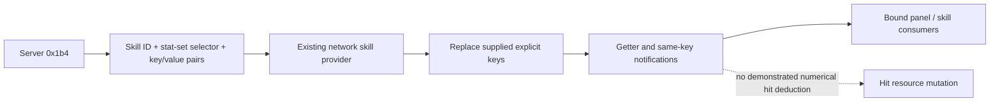

# Supplement: ranged-action research and client damage boundaries (3.29.3b)

## Scope and source identity

[PR #373](https://github.com/LocalExile/LocalExile/pull/373) supplies useful intermediate research on ranged
actions, hit feedback and historical official-server traffic. This supplement checks those inputs against the
[client damage investigation](client-damage-calculation.md). It does not import that PR's server implementation.
No client was started, attached or controlled, and no traffic was captured for this comparison.

The inspected head is `b0afa90ea5c58e9082099d887180df8299dcdaf3` in
[evrydayjunglist/evryPath](https://github.com/evrydayjunglist/evryPath), branch `feature/ranged-monster-actions`.
Its base for this comparison is `c1b112e4890d909a11f612a68702b514e66bdb0d`.
The source PR is now merged; its inspected head is unchanged. This comparison
still uses that pinned revision, rather than treating later repository changes
as additional evidence or importing its implementation.
Hashes below identify the exact Git blob bytes, including their original line endings:

| Repository-relative source at that head | SHA256 |
|---|---|
| `Agents/docs/dev/ranged-monster-actions-port.md` | `5f1f63861fc03b73b6ea42b034faba3228ec2a00cc1da82757876bb1e61aa824` |
| `Agents/docs/protocol/11-skills.md` | `ecb2da3bb404a1fc1450c16296d3de14e169e5e4d80a299b3ed36f2c9100c954` |

The port report describes captures from 2026-10-29 and 2026-10-30. It says the raw captures remain private
because they contain account data. Those raw records and the capture decoder are not available in the inspected
PR tree or this investigation's supplied artifacts. Its references to `research/poe-rea-reference`,
`action-hit-packet-3.29.3b.md` and `server-gaps-3.29.3b.md` are also absent from the inspected PR tree.
Therefore the capture findings below are **author-reported historical observations**, not captures independently
decoded here. Static corroboration of a field's meaning does not verify a reported count or packet sequence.

## Comparison ledger

| Reported finding or hypothesis | Independently established here | Remaining boundary |
|---|---|---|
| No server-created arrow objects in 45 shots; no mortar objects around sampled Sand Spitter attacks | Named Fireball and data-bound Sand Spitter MonsterMortarAttack paths establish local contact/avoidance and distinct continuation tables; default Bow/Wand selection, equipment inputs and startup winners are now [bound statically](client-ranged-action-selection.md) | Packet absence and native-object attribution cannot be independently checked without retained traffic; the selected bow/wand contact callback consumes existing feedback, while its extensions and numerical damage remain separate |
| `0x1af` carries action sequences and a byte called `skill index`, reported as 2 | The byte selects an action instance associated with the sequence; it is not a skill-list lookup in the audited consumer | The value 2 in all sampled hits, and its relation to the reported actions, remain capture claims; [consumer evidence](client-hit-feedback.md) is separate |
| Variable common-header u32 and u16 1 on sampled hits | The common-header fields participate in lockstep scheduling gates | Sample values and packet correlation remain unverified; variation alone does not identify a damage seed |
| `0x1b4` carries a skill ID and compact-int pairs, possibly a shot path | The complete reader-to-consumer path applies **skill stat key/value overrides**, detailed below | Actual keys and values in the reported 27 packets are unavailable; no shot trajectory can be inferred from the report |
| Hit-arrival delays fall in approximately 33 ms steps | The client scheduler and PoB's `0.033` model are already separate, audited clocks | No timestamps were independently fitted here; send gates, release offsets, collision and packet arrival cannot be replaced by a single inferred simulation speed |
| Ten ordinary Sand Spitter hits remove 4 Life; one critical hit removes 5 | The static resource message assigns absolute pool values; it does not attribute a difference to a specific hit | The sample does not establish base damage, roll distribution, mitigation or critical multiplier; the proposed formula remains open |
| Server code uses a 50 ms AI planning cadence | This is an implementation choice visible in the PR source | It is not evidence of an official damage tick or a client Life update cadence |
| The captured monster is reported as SandSpitter12 | The local MonsterVarieties row binds that name to the Sand Spitter base resource; its selected inheritance chain and the selected player chains contain no Actor custom-event fields | This checks the supplied static snapshot, not the capture's entity bytes or loaded resources; [source-chain evidence](client-hit-resource-boundary.md#14-concrete-bundled-source-chains-player-and-sand-spitter) does not exclude other damage paths |

These inputs agree with a split between action/contact feedback, supplied stat values and absolute resource totals.
They do not close numerical hit pre-deduction or the source-instance-to-incoming-DoT-rate edge.

## `0x1b4` is a skill stat update

This is a positive correction to the shot-path hypothesis. It also gives a concrete wire identity to the
[previously audited subsequent skill-provider update](client-stat-evaluation.md#subsequent-network-updates).
The executable and Stats identities are the same pinned inputs as the main investigation.

### Factory and wire reader

Factory `0x1421c6150` constructs a `0x40`-byte record at `0x1421c63b2..0x1421c63ee`.
It stores opcode `0x1b4` at decoded `+8` and installs table `0x1435c21c0`.
Table `+8` is serializer `0x141fdea50`; table `+0x10` is reader `0x141fdeb10`.
The table ends at its own object boundary; subsequent pointer-sized words are not assumed to be its methods.

The reader first calls common world-header reader `0x141f92000`, then reads:

| Wire order after common header | Decoded destination | Consumer meaning |
|---|---|---|
| big-endian u16 | `+0x20` | Skill ID, matched to `ActiveSkillInstance +0x40` |
| u8 | `+0x22` | Stat-set selector: zero primary, nonzero additional set `selector - 1` |
| unsigned compact integer | Count, held locally | Number of stat pairs |
| Repeated unsigned compact integer | Entry `+0` | Stat key |
| Repeated signed compact integer | Entry `+4` | Stat value |

The pair vector is `[message+0x28, message+0x30)`, with capacity end at `+0x38`.
Every entry occupies eight decoded bytes. The compact key reader is `0x14089cad0`; the signed value reader
is `0x141fa3d60`. These are variable-width integers, not two presumed spatial coordinates.
The serializer writes the same fields and uses the corresponding signed/unsigned encoders.

### Dispatch and mutation

Actor dispatcher `0x1421940a0` subtracts `0x1ac`, indexes the byte table at `0x1421957bc`, then the
RVA table at `0x142195778`. Opcode `0x1b4` selects index 5 and target `0x142194482`:

1. Binary-search Actor skill vector `+0x6f0..+0x6f8` by the decoded skill ID. An unknown ID returns.
2. Validate the stat-set selector against the skill's additional-provider vector. An invalid selector reports
   an error and returns. Zero selects skill provider `+0xf8`; a nonzero selector selects the corresponding
   shared provider from `+0x108..+0x110`.
3. At `0x142194640..0x142194659`, load each eight-byte pair. The low 32 bits go to `edx` as key and the high
   32 bits to `r8d` as value; `0x14219464d` calls network setter `0x1424cfaf0`.
4. The setter inserts or replaces that explicit key, including zero, and tail-jumps to same-key notification
   dispatcher `0x1424cfd00`. It does not clear omitted keys or begin the native contribution transaction.
5. The surrounding branch compares selected cooldown values before/after and conditionally updates cooldown
   bookkeeping through `0x141eeb550`. It also visits the selected listener collection.

The compared keys are 6412 `virtual_cooldown_modifier_ms`, 9522 `skill_cooldown_does_not_tick`,
9796 `skill_cooldown_is_4_seconds`, and 18438 `virtual_total_cooldown_count`.
These comparisons do **not** restrict the packet to cooldown keys: the pair loop accepts the transmitted stat keys.
The installed provider's getter still supplies explicit values first and parent fallback only for absent keys.

The packet can change the client-visible skill inputs independently of entity `0x1b3` updates or full skill
creation. Which raw and derived keys the official server chooses to publish is a separate question.
No numerical hit amount or Life/ES/Mana subtraction is introduced by this decoded branch.

## Research continuation

The comparison has produced a verified protocol binding, rather than a reason to adopt another branch's server
calculations. Continue the original work packages with their existing completion criteria:

- R2: follow actual source-instance application and selection/aggregation into incoming rates; keep Buff lifetime
  and refresh evidence separate from damage-magnitude snapshots.
- R3: resolve ordinary bow specialization and trace the remaining numerical path after concrete contacts, then
  follow accepted contacts into numerical amount/critical/mitigation/resource mutation if such a client path exists.
  [The Sand Spitter action](client-hit-production.md#pr-373-follow-up-the-actual-sand-spitter-action) now has its own
  data-to-factory/table binding; shared flight code does not imply identical Fireball continuations.
  Following the actual flight producer now binds its selected `+0x538` receiver to the source Actor;
  both selected Actor callback slots are empty on the three proven tables. The `+0x590` branch has concrete
  attachment/render/animation outputs, with transitive resource/event effects still bounded separately.
- R4: connect source expiry/rate changes and selected event consequences to the already established scheduler.
  Revisit the reported timing and Sand Spitter damage when sanitized, attributable source records become available.

The resumed R2 pass also separates two previously conflated questions. A Buff instance has a refreshable clock,
including an indefinite duration; that is not evidence of a damage-magnitude snapshot or rate publisher.
The RF backend's formerly unclassified lookup resolves art variants and the default `rifire.ao` resource chain,
not a source Entity. See [the concrete lookup](client-dot-routing.md#network-buff-boundary)
for the resource tables, original-byte anchors and remaining producer gap.
The next pass binds owner Stats to poison/bleeding insertion-time clocks and resolves RF refresh/removal
callbacks plus empty tick/insertion slots. These are clock and art lifecycle findings, not a substitute for
named incoming-rate publication. A separate positive `ClientOnlyKillSelf` native callable reaches a Life
absolute-zero setter; it does not connect an accepted contact to a numerical damage amount.

The metadata-only [evidence manifest](client-damage-evidence.json) includes the new factory, reader and compact
integer functions. Private audit batches `r4-pr373-1b4-wire` and `r4-pr373-1b4-compact` retain original-byte ranges
and instruction boundaries. A focused check verifies the dispatch tables, two installed reader/writer slots,
24 instruction anchors and the pinned source hashes. These are offline evidence records, not runtime observations.
