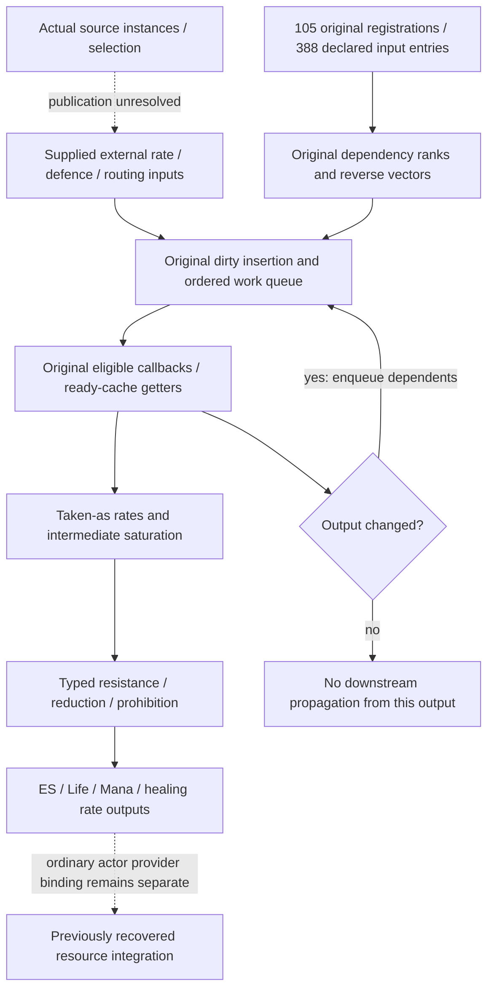

# Native DoT dependency-queue composition (3.29.3b)

## Result and scope

The recovered native dependency engine can compose **105 registered numerical
outputs** from supplied external inputs through DoT mitigation and resource-rate
routing. Eight offline cases execute the original ranking, dirty-queue,
dispatcher, callback and ready-cache getter instructions together. This extends
the [dependency-order algorithm](client-stat-dependency-order.md) beyond isolated
scheduler controls and explicitly staged formula calls.

This is a conditional numerical contract, not an ordinary network Entity or a
real ailment simulation. Native eligibility, ready input caches and the selected
registry are supplied. Actual source infliction, strongest-instance selection,
target-rate publication, shared-cap reachability and expiry withdrawal remain
open. **R2/R3/R4 remain Partial.**

No client was launched or attached, no new captures were acquired, and no server
code was changed. Executable SHA256:
`78a0e227189c263658a7f65a02f086428b859bfc114ae8e7ce8aab721ebd48d5`.
Stats SHA256:
`91c2ed42f6d8094a2704f56aea32f6f16243881b04aadbe4fdbbdd3a566f05da`.
Numeric keys below are one-based Stats keys for this version.

## 1. Executed numerical boundary

The selected graph contains outputs 9563–9590, 3355–3366, 9593–9652 and
2022/2024/2026/5955/6270/9960/9961/17170/18922/18923 where registered.
Its **85 external declared inputs** are supplied cache values, with unassigned
values zero. This is a selected subgraph, not a claim that the full registry has
only these nodes. Declared dependencies are not assumed to exhaust every
possible callback read.

| Address | Executed role |
|---|---|
| `0x142513630` | Registration boundary; each selected original registrar is separately executed up to this call |
| `0x1428e6720` / `0x1428e68b0` | Original declared-dependency rank traversal and rewriting |
| `0x1424fb5f0` | Dirty insertion after changing an external input |
| `0x1424fd490..0x1424fd4e7` | Ordered transaction queue-drain slice |
| `0x1424fcc80` / `0x1424fcec0` | Original dispatch, value publication and changed-result propagation |
| `0x142513520` / `0x1425135a0` | Original ready-cache getters; cache-miss evaluation is outside these cases |
| `0x142513810..0x14251383a` / `0x142513840..0x14251387c` | Explicit bounded rounding leaves, ends exclusive |

The first drain seeds every selected ranked output to establish the numerical
slice. Later input changes execute the actual dirty inserter and growing queue;
the harness does not manually choose the downstream callback order or supply
their numerical answers. Initialization and registry storage are fixtures.

## 2. Eight composition cases

Rates in this table are **damage points per minute**, not a damage budget over
an elapsed minute. For example 60,000/minute is 1,000 DPS. The separately
recovered resource code integrates a rate using `rate / 60 * dt`.

| Case | Supplied inputs / change | Original numerical result |
|---|---|---|
| Live resistance input | Fire base 2023 = 60,000; fire resistance input 17171 changes 0 → 75 → 0 | Typed fire 3356 and ES rate 3361 change 60,000 → 15,000 → 60,000 |
| Unchanged effective resistance | 17171 changes 75 → 100 while maximum 146 remains 75 | Only resistance callback `0x14271a3f0` executes; effective 17170 stays 75, with no changed notification or downstream callback |
| Fire prohibition | Fire base 60,000, resistance 75; prohibition 4522 changes 0 → 1 → 0 | Fire rate changes 15,000 → 0 → 15,000 through the actual queue |
| Separate pool aggregates | Physical and fire inputs each 1,500,000,000; physical ES bypass 3015 = 100 | ES 3361 = 1,500,000,128; Life 3362 = 1,499,999,872; changing bypass to zero gives ES 2,147,483,647 and Life zero |
| Taken-as cap before resistance | Physical and fire each 1,500,000,000; physical taken as fire 15769 = 100; fire resistance 75 | Physical output zero; fire and ES rates 536,870,912. Removing fire resistance gives 2,147,483,647 |
| Mana before Life | Fire 60,000; ES bypass 9677 = 100; Mana share 1694 changes 40 → 0 → 100 | Life/Mana rates change 36,000/24,000 → 60,000/0 → 0/60,000 |
| ES protects Mana | Fire 60,000; Mana share 40; no ES bypass; 5338 changes 0 → 1 | ES/Life changes 60,000/0 → 24,000/36,000; Mana damage rate remains zero |
| Healing route | Fire 60,000; 2784 changes 1 → 0 | Initially damage resource rates are zero and healing 3365 = 60,000; afterward ES damage rate is 60,000 and healing is zero |

These are synthetic input states for distinguishing equations and order. They
are not evidence that a particular item combination or official actor can
produce every supplied value.

## 3. Why cap placement and binary32 order matter

In the taken-as case, the incoming fire channel saturates before resistance.
Applying 75% fire resistance to that saturated channel yields **536,870,912/minute**
under the original binary32 conversion and rounding sequence. Taking an uncapped
3,000,000,000/minute sum and reducing it first would instead give 750,000,000.
One late cap cannot reproduce this case.

The separate-pool case also preserves a useful rounding witness. A supplied
100% physical bypass produces 1,499,999,872 on the bypass branch and a residual
128 on its complement. Together with the fire channel, the two final pool rates
sum mathematically to 3,000,000,000, while directing both channels to ES saturates
that ES aggregate. Replacing the actual ordered percentage arithmetic with an
ideal exact 100% split changes these outputs.

This does **not** establish that the official server lacks a global DoT cap.
It establishes the operations of this client slice under supplied inputs. The
source publisher could constrain the inputs before this slice, and gameplay
reachability remains unresolved. Keep that distinction when using these rules
to design a corresponding server model.

## 4. Fixtures and client/server responsibility

The original numerical callbacks, selected dependency traversal, queue insertion
and dispatch execute offline. The harness explicitly supplies:

- Native owner masks and callback eligibility; this does not bypass the
  [documented ordinary-client native evaluation gate](client-stat-evaluation.md).
- Ready cache values and validity bits, default elemental maximum resistances
  75, materialized records and reserved queue storage.
- Allocation, memory movement and sorting support. The previous-value getter
  reads the existing supplied cache; the separate function-index updater is an
  observational hook and does not compute outputs or mutate the queue.
- Queue-end reset between transactions. Final transaction observers, child
  cleanup and the rest of transaction exit are not executed.

There is no source Entity, skill/Buff constructor, application or target-list
adapter in this batch, and no actual pool deduction. The supplied masks and
input publication must not be promoted into claims of ordinary client authority.
[Network final-rate overrides](client-network-rate-composition.md) and
[Buff removal versus rate withdrawal](client-buff-rate-independence.md) remain
separate established contracts. No official fixed frame cadence is measured here.

## 5. Evidence and reproduction

Private ignored evidence under `Tools/re/out/client-damage-audit/`:

- `r42-dot-native-composition.py` and
  `r42-dot-native-composition/verification.json`: **8 cases, 446,297 interpreted
  instructions, 6,127 visited sites**, including native graph construction.
- `r42-dot-native-fresh.py` and
  `r42-dot-native-composition/fresh-check.json`: **218 function identities,
  282 original-byte ranges, 26,296 decoded instructions**; every visited site is
  on a retained original instruction boundary.
- All **105 registrars** execute to the actual registration boundary and match
  their output, callback and **388 declared input entries**: 1,556 interpreted
  registrar instructions. This verifies the selected declarations anew instead
  of relying only on the older JSON inventory.
- Twenty-three focused original-instruction controls check both reached
  `SBB EAX,EAX` sites and four-lane `CVTDQ2PS`, including signed boundaries and
  binary32 precision loss. They bound these interpreter semantics, not hardware
  execution or a proof of every x86 instruction.

The public [evidence manifest](client-damage-evidence.json) seals the report,
scripts, original records and control results additively. Earlier sealed inputs
are preserved. Counts describe this audit's coverage, not completed mechanics.
