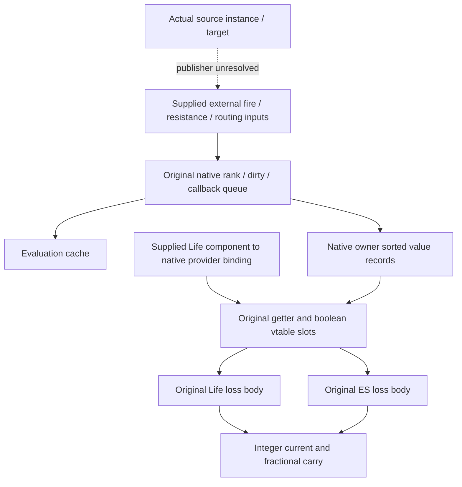

# Native DoT records through numerical pool loss (3.29.3b)

## Result and scope

The [native DoT dependency-queue composition](client-dot-native-composition.md)
now has two further original-instruction continuations:

1. The actual native getter reads the owner's presence bitmap and sorted value
   records instead of a script substituting its previous value. All eight
   preceding numerical witnesses remain identical.
2. With a native provider explicitly bound to a supplied Life component, the
   actual getter and boolean interface carry the computed rates into original
   Life and ES numerical loss bodies. Six compositions execute 24 loss steps;
   no script copies the calculated rate into a resource-provider answer.

This closes a **conditional native-provider numerical path**, not an ordinary
network actor's provider selection. The source instance, application, selection,
target-rate publisher and native eligibility remain separate supplied/open
boundaries. It does not close accepted-Hit damage, shared-cap reachability or
generic existing-Buff clock refresh. **R2/R3/R4 remain Partial.**

All controls interpret original instructions offline. No client was launched or
attached, no new captures were acquired, and no server code or CI was changed.
Executable SHA256:
`78a0e227189c263658a7f65a02f086428b859bfc114ae8e7ce8aab721ebd48d5`.
Stats SHA256:
`91c2ed42f6d8094a2704f56aea32f6f16243881b04aadbe4fdbbdd3a566f05da`.

## 1. Real previous-value lookup and publication

Native root table `0x14363d3b0` installs getter `0x1424fc1e0` at slot zero
and boolean wrapper `0x1424fb5a0` at slot eight. These identities were already
bound in [stat evaluation](client-stat-evaluation.md); their original pointer
bytes are checked again for this composition.

| Original site | Operation |
|---|---|
| `0x1424fc20b` | Load the owner's presence bitmap from `+0x268` |
| `0x1424fc228` | `BT EAX,ECX` selects the key's presence bit |
| `0x1424fc231` / `0x1424fc23b` | Load the native sorted-record begin/end at `+0x1f0/+0x1f8` |
| `0x1424fc260..0x1424fc2a8` | Binary-search the key in 40-byte records |
| `0x1424fc2c3` | Return record value `+8`; missing keys can consult the native parent or return zero |
| `0x1424fcdb3` | Actual numerical dispatcher publishes a changed result to record `+8` |

The harness supplies the 105 selected records and their presence bits. It
removes the preceding batch's previous-value hook; it does not replace the
getter with another script. The dispatcher still computes cache values and
updates records through its original instructions. After each of 19 queue
drains, all selected cache/record values are compared: **1,995 comparisons**
agree.

The effective-resistance witness remains significant. Changing supplied raw
fire resistance from 75 to 100 while the maximum remains 75 executes only
`0x14271a3f0`; the original previous-value lookup finds the existing 75, so
there is no changed notification or downstream calculation. This now relies
on real native record reads rather than the substituted cache lookup.

Twenty-four bounded original `BT EAX,ECX` controls check zero/all-one words,
the high bit and register bit-index wrapping. Only the carry flag is defined
by this instruction for the following branch; preserving other flag fields in
the interpreter is not a claim that the CPU defines them.

## 2. Shared native records feed the actual pool getter

The native graph and resource object fixtures share one interpreter memory
space and allocator. The Life component's selected Stats-provider field
`[Life+0x168]+0x20` points to that same native owner. Its table is the original
`0x14363d3b0`, not a custom provider table.

The Life loss body `0x141e6ae70` and ES loss body `0x141e6b480` execute original
virtual getter calls. Boolean wrapper `0x1424fb5a0` itself calls the original
getter and tests its result. All **303 native getter reads** during the 24
steps are checked against the supplied native owner; the relevant 3362 Life
or 3361 ES rate is actually requested. Scalar resource getters are removed,
and neither a copied-rate adapter nor a network override substitutes a value.

Life and ES are tested separately with surviving resources, supplied deltas
0.016, 0.033 and 0.1, current 1,000, maximum 1,100 and initial fractional carry
0.25. Life tests supply fire ES bypass 9677 = 100; ES tests leave it zero.
Each four-step sequence uses the original queue to apply these changes:

| Step | Supplied external state | Resulting selected rate per minute |
|---|---|---:|
| 1 | Fire base 2023 = 60,000; raw fire resistance 17171 = 0 | 60,000 |
| 2 | Change resistance 17171 to 75 | 15,000 |
| 3 | Set fire prohibition 4522 to one | 0 |
| 4 | Clear prohibition 4522 | 15,000 |

For delta **0.033**, both selected loss bodies produce:

| Step | Current after loss | Fractional carry |
|---|---:|---:|
| 1 | 968 | -0.75 |
| 2 | 959 | 0 |
| 3 | 959 | 0 |
| 4 | 951 | -0.25 |

The zero-rate step preserves both current and carry in these supplied states.
The retained fraction explains why step one loses 32 integer points rather
than discarding the fraction independently at each step. Numerical comparisons
preserve the separately recovered Life/ES binary32 operation order. A supplied
0.033 delta is not evidence of official fixed cadence or time quantization.

## 3. Remaining fixtures and authority boundary

Both batches supply native eligibility, ready external caches and record
existence. The queue still has the preceding allocation/sort support,
observational function-index updater and explicit between-drain cleanup.
The resource composition additionally supplies the component/provider binding,
resource layout and maxima, reservation-policy helpers, absent protective-Buff
lookup, empty threshold/lifecycle listeners and observational notifications.

These are selected numerical loss-body executions, not a replay of the whole
component scheduler, ES depletion into Life, all protection callbacks or a
real Entity construction. They do not establish that an ordinary network actor
chooses this native provider, that an owner timing-stat update refreshes an
existing Buff, or that the server sends any particular sequence.

The already established [received-rate path](client-network-rate-composition.md)
remains another authority boundary. A server reconstruction can reuse the
recovered numerical rules while separately implementing source-instance
selection, publication/withdrawal and network synchronization. The client
composition alone does not supply those missing algorithms.

## 4. Evidence and reproduction

Private ignored evidence under `Tools/re/out/client-damage-audit/`:

- `r43-dot-original-old-value.py` and
  `r43-original-old-value-fresh.py`: eight unchanged witnesses, **586,210
  interpreted instructions / 6,184 visited sites**, 1,995 record/cache
  comparisons and 24 original-instruction controls. Fresh checks cover
  **219 identities / 283 ranges / 26,367 decoded instructions**, including six
  original lookup/publication anchors.
- `r45-native-pool-composition.py` and `r45-native-pool-fresh.py`: six
  compositions / 24 pool steps / 303 native getter reads, **496,629 interpreted
  instructions / 6,663 visited sites**. Fresh checks cover **248 identities /
  328 ranges / 28,534 decoded instructions** and two original table slots.

Each batch retains `audit.json`, `verification.json` and `fresh-check.json` in
its corresponding output directory. Original byte identities, visited
instruction boundaries and parent-input hashes are checked before additive
sealing in the [evidence manifest](client-damage-evidence.json). Earlier sealed
reports and producers are preserved; these counts are not completed-mechanic
counts.
