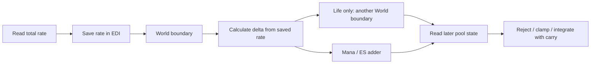

# Client resource-rate capture and later state reads (3.29.3b)

A resource step does not use one immutable snapshot of every input. Recovery
captures its total rate before a World boundary but reads resource state later.
Life loss channels read their rates sequentially; ES captures three loss rates
before applying any of them. These differences matter when an intervening
notification changes state. They do not establish arbitrary sub-frame splitting.

This extends [resource timing](client-damage-timing.md) and
[recharge/rate authority](client-recharge-rate-authority.md).
R0/R1 remain Established; R2/R3/R4 remain Partial. No client, native target code,
new capture, server or CI was run. Addresses are preferred VAs, base `0x140000000`.

| Input | SHA256 |
|---|---|
| Original `Client/Game.exe` | `78a0e227189c263658a7f65a02f086428b859bfc114ae8e7ce8aab721ebd48d5` |
| `Stats.json`; native key = row + 1 | `91c2ed42f6d8094a2704f56aea32f6f16243881b04aadbe4fdbbdd3a566f05da` |

## Recovery saves the rate, not the whole pool state

In common controller `0x141e6b320`, the retained owner's total-recovery getter
returns at `0x141e6b418`; `0x141e6b41e` saves its integer result in EDI.
The controller then calls World `+0x90` at `0x141e6b42b`. Both previously bound
World tables, `0x1435da318` and `0x14346e0c8`, select `0x142183840` for this slot.
This investigation binds the resource-side call and its saved values; the
World function's internal message-dispatch semantics remain a separate task.

After that call, the controller tests the **saved EDI**, converts it to
binary32 and calculates `(float(rate) / 60) * suppliedDt`. A later change to the
provider's same key cannot replace this captured value in this invocation.
Even a captured nonpositive rate passes through the World call before the
positive-rate test; changing zero to positive there does not initiate recovery.

The actual recovery methods then read later state:

| Pool | Actual method | Later inputs |
|---|---|---|
| Life | `0x141e69e50` | Saves delta in XMM6; calls World `+0x90` again at `0x141e69e78`; then reads policy capacity, current and carry |
| Mana | `0x141e6a600` | Reads recovery-block byte `+0x24`, carry, reservation and current |
| ES | `0x141e6c140` | Reads policy capacity/current/carry, then enters common `0x141e6a600`, which reads the block byte |

Life and ES cap a positive proposed gain against their later policy space.
All three ultimately use the later block byte and current/carry through the
common adder. Thus a previously captured rate can be applied to an updated
integer current, capped against a changed capacity, or rejected by a newly set
recovery-block byte. This is not a second rate lookup.

Conditional original-instruction controls make the distinction concrete.
Initial current 100, maximum 1,000, carry 0.25, rate 6,000/min and `dt=0.033`:

| Supplied change at first World boundary | Outcome |
|---|---|
| Provider rate becomes zero; actual assignment receiver sets current to 250 | All three pools end at integer 253, carry about 0.55; saved rate still supplies about 3.3 gain |
| Initial rate was zero and becomes 6,000/min | No gain; original current/carry remain |
| Actual recovery-block subscriber sets the selected block byte | Gain is rejected; original current/carry remain |

For Life, assigning current 999 at its second World boundary instead produces
current 1,000 and carry zero: the wrapper clamps the saved positive delta to
the later available space. The assignment receiver preserves carry; the gain
path performs this final clamp.

The controls supply the World-boundary changes explicitly. They execute the
actual absolute setter `0x141e69fb0` and recovery-block subscriber `0x141e6c350`,
but do **not** claim these messages were queued or dispatched by the real World
in that order. No packet header, timing or actual queued-message execution is
inferred from the fixtures.

## Life and ES capture loss rates at different points

After recovery and selected flask/leech gain, Life step `0x141e6ae70` calls
World `+0x90` at `0x141e6af61`. It then follows this sequence:

| Order | Key | Operation |
|---:|---|---|
| 1 | 7599 `virtual_life_degeneration_per_minute` | Read rate; apply reason-4 Life loss |
| 2 | 3362 `total_damage_taken_per_minute_to_life` | Read rate; apply reason-1 lethal Life damage |
| 3 | 21052 `virtual_non_lethal_life_degeneration_per_minute` | Read rate; apply reason-4 nonlethal Life loss |
| 4 | 3364 `total_nonlethal_damage_taken_per_minute_to_life` | Read rate; apply reason-1 nonlethal Life damage |

Each positive rate is scaled immediately before its operation. The read of
3362 is at `0x141e6afb1`, **after** the earlier loss call `0x141e6afa1` returns.
Likewise later keys are read after earlier channel processing. The installed
Life `+0x148` aggregate notification is an exact no-op; it does not retrospectively
replace these individual loss amounts.

ES step `0x141e6b480` instead reads 3361, 3363 and 12609 into XMM10, XMM9 and
XMM8 respectively at `0x141e6b4cc/0x141e6b4f4/0x141e6b514`, before its first
loss call at `0x141e6b54a`. A change to 3363 during that first loss does not
replace the already captured second amount. The reducers can still read later
resource state and routing inputs: this is not an assertion of an immutable
snapshot of all ES policy. Mana also has multiple reads and overflow paths;
its complete ordering is not generalized from either Life or ES here.

Preserve arithmetic order as well. Life uses `(float(rate) / 60) * dt` for
these channels; ES uses `(float(rate) * dt) / 60`. The real binary32 operations
are retained, rather than algebraically normalizing them in an implementation.

## Actual callback boundaries demonstrate the consequence

Life's loss preparation `0x141e6acc0` walks the owner's configured threshold
rows. It compares the proposed resource state with a row's integer percentage
threshold, enters script dispatcher `0x141de6000` at `0x141e6ad7c`, dispatches
the threshold listener, increments pool byte `+0x49` and rechecks the rows.
This is a concrete callback boundary **before** the pending common loss is
applied, rather than an invented event between arbitrary instructions.

ES's common loss writes current/carry, then invokes installed pool `+0x58`;
`0x141e6bd80` can dispatch its one-time script at `0x141e6bdba`. That boundary
is **after** the first common loss, but still before ES's later channel calls.
These resource-side bindings complement the [existing event boundary](client-hit-resource-boundary.md).
Full script consequences remain outside this audit.

An illustrative pair uses `dt=0.12`, current 1,000, maximum 1,100, carry 0.25,
first loss rate 6,000/min and a later damage rate initially 6,000/min.
At the actual script boundary, a fixture changes that later rate to 18,000/min:

| Path | Later rate used now | Final integer current | Final carry | Combined resource |
|---|---:|---:|---:|---:|
| Life: configured 90% threshold callback during generic loss | 18,000/min | 953 | -0.75 | 952.25 |
| ES: one-time loss notification after first damage channel | Captured 6,000/min | 977 | -0.75 | 976.25 |

The Life control starts with the unrelated one-time loss notification already
delivered, so the configured threshold event is isolated. ES uses the original
one-time notification path. Script-side rate changes are deliberately supplied
fixtures; this does not establish an actual game script that publishes those
rates. The example establishes the numerical consequence **if** such an update
occurs at that bound callback. Fractional carry explains why integer current
alone is not the integrated resource total.

## Verification and remaining gates

Thirty retained bodies / 46 original ranges / 2,171 decoded records were freshly
checked. These are mostly reused resource functions, not 30 new discoveries.
There are **509 controls / 103,463 interpreted original instructions / 891 visited
sites**, with separate scalar results and chronological trace assertions.
Fresh checks bind 46 instruction anchors and nine concrete table slots.

The offline interpreter runs actual controller, setter, recovery-block listener,
threshold walker, loss notification and selected gain/loss arithmetic.
Providers, flat reservation and policy capacity, absent protective-Buff lookup,
threshold-listener dispatch, World dispatch and script-side mutations are explicit
fixtures. Finite surviving-target controls exclude NaNs, full transitive scripts,
arbitrary packet interleaving and outer gameplay eligibility. Verification is
same-agent, not an independent worker or native execution.

Ignored evidence: `Tools/re/out/client-damage-audit/r25-resource-read-order.py`,
`r25-resource-fresh.py` and `r25-resource-read-order/{audit,verification,fresh-check}.json`.
The [manifest](client-damage-evidence.json) seals provenance.

This closes specific capture/read-order contracts. It does not close accepted
Hit amount/critical/mitigation-to-pool, source-DoT selection/aggregation/cap/rate
publication or generic existing-Buff timing-stat refresh. Nor does it split an
integration step at an arbitrary expiry time or recover official-server scheduling.
